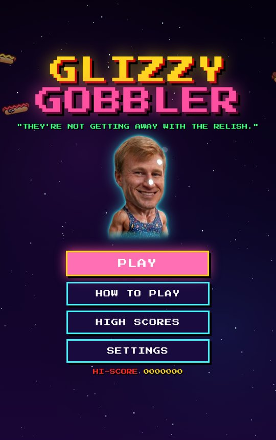
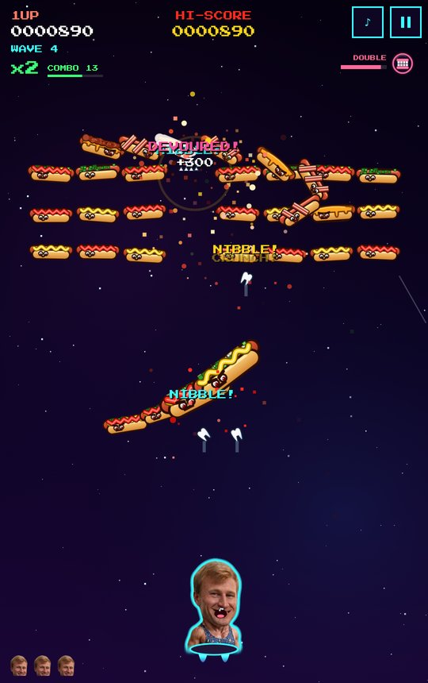
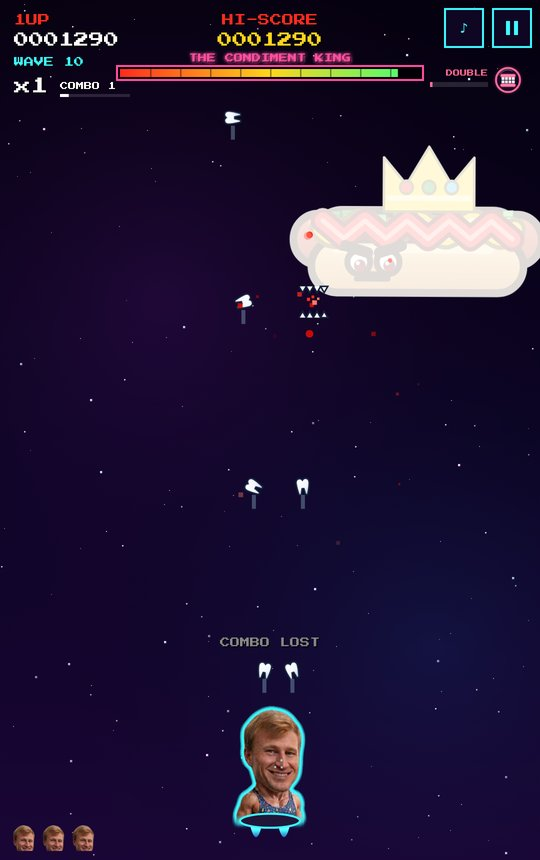

# 🌭 Glizzy Gobbler 🦷

### *"THEY'RE NOT GETTING AWAY WITH THE RELISH."*

A ridiculous retro arcade space shooter. Space is full of hotdogs, and the only thing standing in their way is one floating hero who shoots **teeth out of his mouth**.

**▶ Play it:** https://darkness-alone.github.io/Hotdog-Lover/ *(once GitHub Pages is enabled, see [Hosting](#hosting) below)*

<p align="center">
  
  
  
</p>

---

## How to play

Hotdogs swoop in, line up in formation, then dive-bomb you while firing condiments. Shoot them with teeth, dodge the ketchup, and eat every last one.

**You don't kill hotdogs. You eat them.** Each tooth either strips a topping or takes a bite, until the whole glizzy is gobbled:

> Full dog with ketchup, mustard and relish → relish gone → mustard gone → ketchup gone → *bite* → **GOBBLED!**

Hit without missing to build a **combo multiplier** (up to **x8**). A tooth that flies off the top of the screen resets it.

### Controls

| | Desktop | Mobile |
|---|---|---|
| Move | `←` `→` or `A` `D` | Touch and slide anywhere on the screen |
| Shoot teeth | `Space` (hold) | Automatic while your finger is down |
| Pause | `P` or `Esc` | ❚❚ button, top-right |
| Mute | `M` | ♪ button, top-right |

On mobile, just touch and hold: he fires automatically while you steer. Keyboard players can turn on auto-fire while moving in **Settings**. It works in both portrait and landscape.

---

## The menu (enemies)

| Hotdog | Bites to eat | Notes |
|---|---|---|
| Ketchup Dog | 2 | Squirts ketchup |
| Mustard Dog | 2 | Squirts mustard |
| Relish Dog | 3 | Lobs relish chunks |
| The Works | 5 | Ketchup, mustard *and* relish |
| Chili Cheese Dog | 4 | Fires a 3-way chili spread |
| Bacon-Wrapped Dog | 4 | Three strips of bacon armor |
| Mutant Dog | 4 | Three eyes, erratic flight, **splits** when eaten |
| Giant Dog | 8 | Enormous, **splits** into mini-dogs |

Waves get faster, more aggressive and more crowded as you go.

## Power-ups

Eaten hotdogs sometimes drop power-ups. Fly into one to grab it.

| Power-up | Effect |
|---|---|
| 🦷 **Tooth Machine Gun** | Rapid-fire teeth |
| 🥇 **Golden Tooth** | Each tooth strips 3 toppings at once |
| 🧵 **Dental Floss** | Wide floss lines that slice through whole rows |
| 🛡️ **Braces** | A shield that blocks enemy attacks |
| 🫧 **Mouthwash** | Instantly rinses every enemy shot off the screen |
| 😁 **Double Dentures** | Two streams of teeth |
| 🪨 **Giant Molar** | Huge molars that plow through multiple dogs |
| 🍬 **Sugar Rush** | Faster movement and firing |

## Bosses

A boss shows up every 5th wave, with a health bar and its own attack patterns:

1. **The Mega Chili Dog** (wave 5): chili spreads, exploding cheese bombs, and swarms of mini-dogs.
2. **The Condiment King** (wave 10): aimed ketchup bursts, mustard spirals, and relish rain.
3. **The Bratwurst Beast** (wave 15): armor plates you have to crack first, then it charges straight at you.
4. **The Ultimate Combo** (wave 20): every topping imaginable and every attack, getting nastier as it loses health.

After that the cycle repeats, tougher each time. Bosses explode into a shower of toppings and sausages when defeated.

## Scoring

- **10 points** per hit, plus a bonus for each hotdog fully eaten, all multiplied by your combo.
- **Wave-clear bonuses** for accuracy, and for finishing a wave without getting hit.
- **Big bonus** for defeating a boss.
- **Extra lives** at 15,000 and 40,000 points, then every 40,000 after that.
- A **World Top 10** leaderboard for everyone who plays, plus your top 8 personal scores saved in your browser.

---

## World leaderboard

Scores can go on a shared **World Top 10**, stored in a free [Supabase](https://supabase.com) database. After a game over, players type a name of up to 10 characters and submit their score. The **High Scores** screen has a **WORLD** tab and a **MINE** tab for scores on that device.

To set it up:

1. In the Supabase dashboard, open **SQL Editor → New query**, paste in [`supabase/leaderboard.sql`](supabase/leaderboard.sql), and click **Run**. This creates the `scores` table and only lets players read the board and add scores.
2. Copy the public **anon / publishable** key from **Project Settings → API** into `KEY` in [`js/leaderboard.js`](js/leaderboard.js). Never use the `service_role` key here.

If the key is blank or the database can't be reached, the game still works and keeps scores on the device only. To remove a bogus score, delete its row in Supabase's **Table Editor**.

## Running it

No build step and no dependencies. It's plain HTML, CSS and JavaScript. Either open `index.html` in a browser, or serve the folder:

```bash
python3 -m http.server 8000
# then open http://localhost:8000
```

### Hosting

To get the public play link above:

1. Merge the game into `main`.
2. On GitHub, go to **Settings → Pages**.
3. Under **Build and deployment**, set **Source** to *Deploy from a branch*, **Branch** to `main`, and folder to `/ (root)`. Click **Save**.
4. After a minute or two, the game is live at **https://darkness-alone.github.io/Hotdog-Lover/**.

## Project layout

| File | What it does |
|---|---|
| `index.html` | Page structure and all menu screens |
| `style.css` | Retro neon styling and the responsive layout |
| `js/game.js` | Game loop, player, enemy AI, bosses, power-ups, scoring, HUD |
| `js/sprites.js` | Procedurally drawn and cached art: hotdogs, toppings, teeth, power-ups |
| `js/leaderboard.js` | World leaderboard: reads and submits scores through the Supabase REST API |
| `supabase/leaderboard.sql` | One-time database setup for the world leaderboard |
| `js/audio.js` | Synthesized sound effects and the chiptune music sequencer (Web Audio, no sound files) |
| `assets/player.png` | The player character |
| `docs/` | Screenshots for this README |
